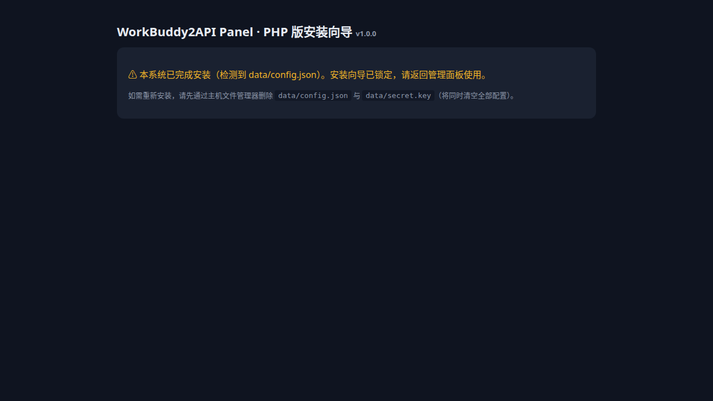
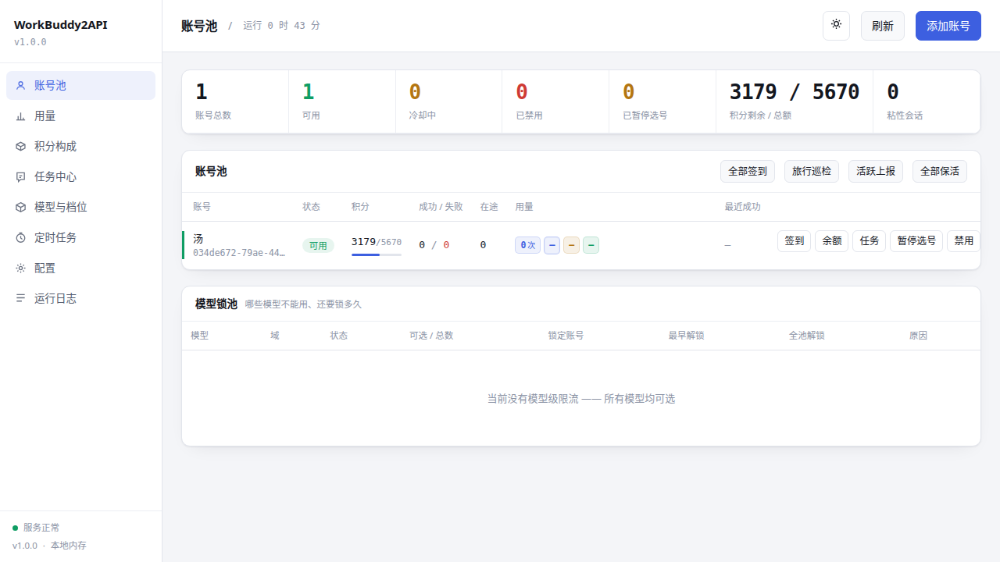
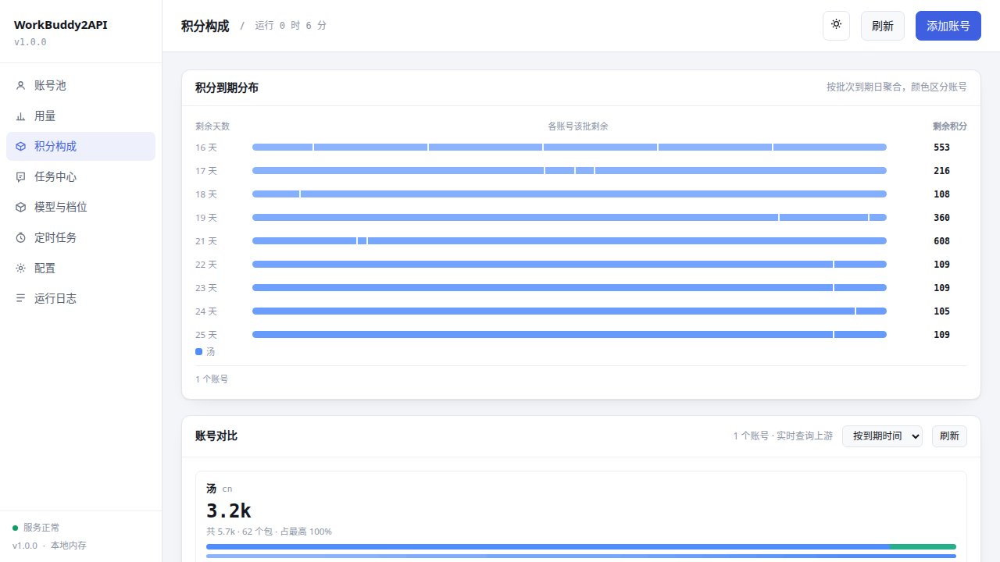
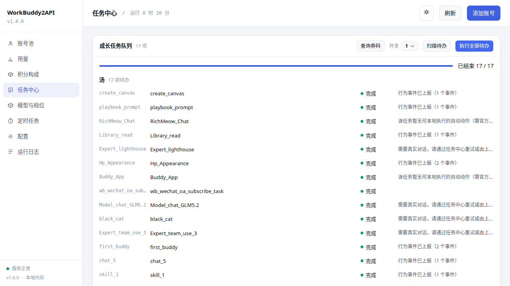
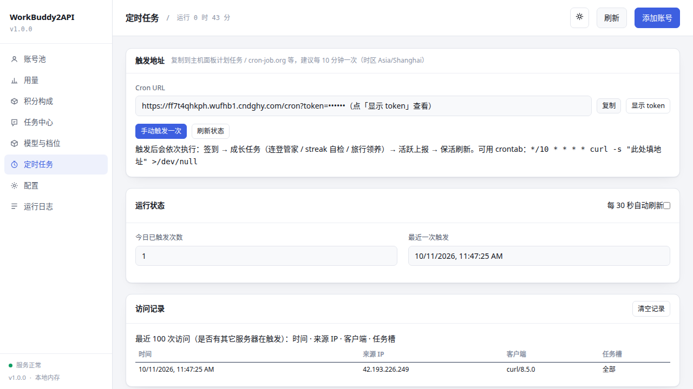

# WorkBuddy2API Panel · PHP 版

<p align="center">
  <b>把腾讯 CodeBuddy 账号变成 OpenAI 兼容 API 的多账号网关 —— 专为普通 PHP 虚拟主机打造</b><br>
  无 SSH · 无 Docker · 无独立端口 · 无常驻进程 · 上传解压 → 浏览器安装 → 直接用
</p>

<p align="center">
  
  
  
  
  
</p>

> 本项目是 [Sliverkiss/workbuddy2api](https://github.com/Sliverkiss/workbuddy2api)（Go 版）的 **PHP 完整重构版**，功能对齐 Go 原版，并针对「只有 FTP 和数据库的虚拟主机」做了深度适配与增强。

---

## ✨ 它能做什么

腾讯 CodeBuddy 的个人账号自带每月免费积分（体验版 5000+/月）。本项目把这些账号汇成一个**账号池网关**，对外暴露标准 OpenAI 接口，任何支持自定义 base_url 的客户端（Cherry Studio、NextChat、LobeChat、沉浸式翻译……）都能直接用：

- `POST /v1/chat/completions` —— OpenAI 兼容对话（SSE 流式 / 非流式聚合）
- `GET /v1/models` —— 动态模型列表（含负缓存）
- `GET /status`、`GET /healthz` —— 账号池状态与探活
- **账号池调度**：积分加权 + 快过期优先 + 闲置补偿 + Top-5 候选随机 + 防惊群 + 会话粘性
- **六级冷却体系**：429 软冷却指数退避 / 模型级冷却（不罚号）/ 402 硬冷却至次日 4:00 / 404 短冷却 / 连续失败熔断 / 连败降权 / 12153 三振禁用
- **保号自动化**：每日签到（连登兑换+抽奖）、成长任务自动执行（17 项）、活跃上报、猫猫旅行、夜猫子、token 保活、余额刷新
- **Web 管理面板**：账号池 / 用量 / 积分构成 / 任务中心 / 模型档位 / 定时任务 / 配置 / 运行日志
- **安全**：凭证 AES-256-GCM 加密、常量时间密钥比较、敏感目录 Web 层硬拦截、日志脱敏

## 🖼 界面预览

| 安装向导（环境检测 + 存储选择 + 一键连通性实测） |
| --- |
|  |

| 账号池（实时额度 / 冷却状态 / 保号操作） | 积分构成（周期分布 + 账号对比） |
| --- | --- |
|  |  |

| 任务中心（扫描 → 一键执行，17 项成长任务） | 定时任务页（触发地址 / 手动触发 / 访问审计） |
| --- | --- |
|  |  |

## 🚀 快速部署（三分钟）

1. **上传**：把项目解压上传到网站根目录（Apache/Nginx/IIS 均可，IIS 已内置 `web.config` 伪静态与敏感目录拦截）。
2. **安装**：浏览器访问 `https://你的域名/`，自动进入安装向导：
   - ① 环境检测（真实写入探针，不用不可靠的 `is_writable`）
   - ② **选择存储方式**（三选一，点「测试存储连接」实测通过后才能完成安装）：
     - **MySQL 数据库**（推荐）：填空间自带的 MySQL 信息，数据存库，重启/清缓存都不丢
     - **SQLite**：单文件数据库，存于 `data/`（要求该目录可写）
     - **本地文件**：`data/store.json`（兜底方案）
   - ③ 完成：自动生成 `api_key` 与 `cron_token`；若之前用过文件存储，**旧数据自动迁移**到所选后端
3. **添加账号**：打开 `/panel/`，粘贴 api_key → 「添加账号」→ 浏览器内完成 OAuth 登录。
4. **客户端接入**：`base_url = https://你的域名/v1`，`api_key = 安装时生成的密钥`。
5. **定时任务**（二选一即可）：
   - 主机面板：每 10 分钟访问 `https://你的域名/cron?token=<cron_token>`
   - 任意服务器 crontab：`*/10 * * * * curl -s "https://你的域名/cron?token=<cron_token>" > /dev/null`
   - 免费托管：[cron-job.org](https://cron-job.org) / UptimeRobot 建一个 HTTP 监控

## 💾 存储方式对比

| | MySQL（推荐） | SQLite | 文件 |
| --- | --- | --- | --- |
| 数据安全 | ★★★ 数据库持久化 | ★★★ 单文件库 | ★★ 依赖目录权限 |
| 高并发写入 | ★★★ | ★★ | ★（整文件锁） |
| 需要可写目录 | 否 | 是（data/） | 是（data/） |
| 适用场景 | 虚拟主机自带数据库 | 轻量 VPS | 纯静态空间兜底 |

> 虚拟主机常见坑：`data/` 目录 Web 运行账号不可写。本项目安装向导会**实测写入**并明确提示；选 MySQL 则完全绕开这个限制。

## 📊 对比 Go 原版：这个 PHP 版的优势

两个版本功能等价（面板前端原样保留），但面向的运行环境与运维成本完全不同：

| 维度 | Go 原版 | PHP 版（本项目） |
| --- | --- | --- |
| **部署门槛** | 需要 SSH/服务器，编译或下二进制，配 systemd，占独立端口 | **FTP 上传解压即可**，5 块钱/月的共享虚拟主机就能跑 |
| **常驻进程** | 需要常驻后台进程，主机重启要手动拉起 | **零常驻**，请求驱动 + `/cron` 调度，天然不怕重启 |
| **数据库支持** | 文件/内存为主（Upstash Redis 需另购） | **安装时三选一**：MySQL / SQLite / 文件，实测连通才放行 |
| **HTTPS 证书** | 依赖系统 CA | 内置 `cacert.pem`，无系统证书库的主机也能正常连上游 |
| **IIS / Windows 主机** | 基本不支持 | 内置 `web.config`（URL Rewrite + 敏感目录 requestFiltering） |
| **安装体验** | 命令行配置 | **浏览器图形化安装向导**：环境自检 + 存储实测 + 密钥生成 |
| **定时任务可视化** | 无（日志翻找） | **独立「定时任务」页**：触发地址复制、手动触发、今日计数、最近 100 次访问审计（IP/UA），一眼确认外部 cron 是否在打 |
| **任务中心执行引擎** | 后台队列 | 适配共享主机 30s 执行上限：**前端逐任务驱动**，17 项成长任务实测全程可跑完，含真实对话任务诚实回报（不虚报） |
| **升级方式** | 重新编译/换二进制 | 覆盖上传 PHP 文件即完成升级 |
| **可审计性** | Go 源码 | 全部 PHP 明文源码 + 53 项自动化回归测试 |

**什么情况下仍应选 Go 原版**：你有自己的 VPS、需要极限吞吐/长驻内存缓存、或想二开机器人生态 —— Go 的性能上限更高。PHP 版的目标是把门槛降到「任何会传 FTP 的人」。

## 🔧 技术要点

- **零依赖**：不 require Composer，只用 PHP 内置扩展（PDO / cURL / OpenSSL / mbstring）
- **存储抽象**：`Store` 类统一路由 KV / 账号 / 粘性会话 / 请求日志 / 用量桶，业务层不碰 SQL；`importFromFile()` 保证存储后端间无损迁移
- **SSE 流式**：cURL `WRITEFUNCTION` 直通 + `idle_timeout` 低速探活；`header('X-Accel-Buffering: no')` 兼容 Nginx 反代
- **6004/6002 模型级限流**：模型级冷却不惩罚账号，`model_locks` 聚合视图，换模型豁免
- **测试**：`php tests/run_tests.php` 启动内置服务器跑 53 项断言（网关语义 / 冷却 / 粘性 / 安全头 / OAuth mock）

## 📁 目录结构

```
├── index.php            # 前端控制器（路由 + 安全拦截）
├── web.config           # IIS 伪静态 + 敏感目录硬拦截
├── install/             # 浏览器安装向导（环境检测/存储实测/密钥生成）
├── panel/               # 管理面板（单页应用，原版前端保留 + 增强）
├── app/
│   ├── Core/            # Env / Config / Store(文件|MySQL|SQLite) / Http / Crypto
│   ├── Api/             # PanelApi / StatusApi / CronApi / TaskRunner
│   ├── Upstream/        # 上游 Client / Headers / Classify（提示词与 DSML 管线）
│   └── Pool.php         # 账号池：选号 / 冷却 / 熔断 / 粘性
├── docs/                # 部署 / 使用 / 安全 / 排障文档
├── tests/run_tests.php  # 53 项自动化回归
└── data.template/       # 数据目录模板
```

## ❓ 常见问题

<details>
<summary><b>安装时提示 data 目录不可写？</b></summary>

在主机面板把 `data/` 目录权限设为 755/775，并确认属主与 Web 运行账号一致（共享主机常见：FTP 用户 ≠ IIS 应用池用户）。若主机面板无法改属主，**直接选 MySQL 存储**即可完全绕开本地写权限问题。
</details>

<details>
<summary><b>添加账号时 OAuth 报「缺少状态或认证 URL」？</b></summary>

主机 PHP 缺 CA 证书库。本项目已内置 `app/cacert.pem` 自动生效；若仍失败，检查主机是否禁用了 `curl_exec`。
</details>

<details>
<summary><b>任务执行部分提示「需要真实对话」？</b></summary>

部分成长任务的进度只在官方客户端链路上累计，网关侧的行为事件上报无法推进。执行器会如实标注，不会伪造进度；对话类任务（如 chat_5）在真实调用 API 后自然完成。
</details>

## 📄 许可与致谢

- 本项目基于 [Sliverkiss/workbuddy2api](https://github.com/Sliverkiss/workbuddy2api)（MIT）重构，感谢原作者；面板单页前端沿用原版并做了 PHP 后端适配与增强
- 本项目以 MIT 许可开源
- 仅供学习研究，请遵守腾讯 CodeBuddy 服务条款，勿用于商业用途
